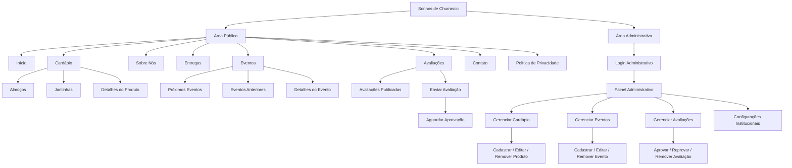
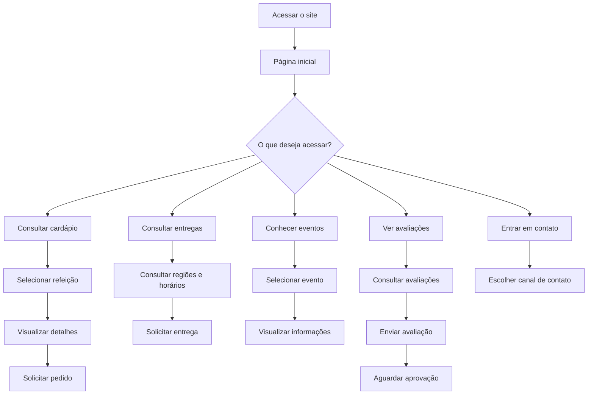
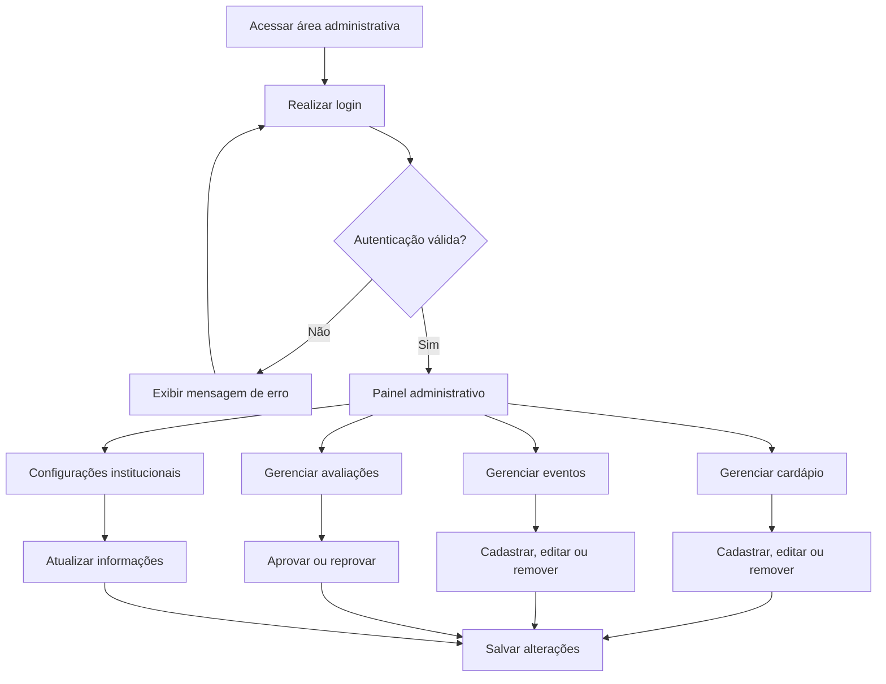

# **Arquitetura da Informação — Sonhos de Churrasco**

DOCUMENTAÇÃO DE UX/UI · SITEMAP · ESTRUTURA DE NAVEGAÇÃO

## **1. Visão geral da arquitetura**

A arquitetura da informação do site **Sonhos de Churrasco** será organizada para facilitar o acesso às informações mais importantes do restaurante, principalmente cardápio, entregas, eventos e avaliações.

Considerando que o público-alvo é composto principalmente por famílias, a navegação deverá ser simples, visual e objetiva, evitando menus complexos e excesso de informações na página inicial.

A estrutura será dividida em duas áreas principais:

1. **Área pública:** destinada aos clientes e visitantes do restaurante.
2. **Área administrativa:** destinada aos responsáveis pelo gerenciamento do conteúdo do site.

### **Estrutura principal**

## **Sonhos de Churrasco**

SITE INSTITUCIONAL

**Área pública**

Acesso dos clientes

Início

Cardápio

Sobre nós

Entregas

Eventos

Avaliações

Contato

**Área administrativa**

Acesso restrito

Painel inicial

Cardápio

Eventos

Avaliações

Informações do site

Sair

## **2. Identificação das páginas necessárias**

O projeto contará com as seguintes páginas e estruturas:

| Nº | Página                       | Finalidade                                                   |
| -- | ---------------------------- | ------------------------------------------------------------ |
| 01 | Página inicial               | Apresentar o restaurante e seus destaques.                   |
| 02 | Cardápio                     | Exibir os produtos disponíveis.                              |
| 03 | Detalhes do produto          | Apresentar informações completas de uma refeição.            |
| 04 | Sobre nós                    | Apresentar a história e a proposta do restaurante.           |
| 05 | Entregas                     | Informar condições e regiões de entrega.                     |
| 06 | Eventos                      | Divulgar eventos realizados pelo restaurante.                |
| 07 | Detalhes do evento           | Apresentar informações específicas de cada evento.           |
| 08 | Avaliações                   | Exibir opiniões e permitir o envio de avaliações.            |
| 09 | Contato e localização        | Disponibilizar canais de comunicação e endereço.             |
| 10 | Política de privacidade      | Informar como os dados pessoais são tratados.                |
| 11 | Login administrativo         | Permitir acesso dos responsáveis pelo site.                  |
| 12 | Painel administrativo        | Centralizar o gerenciamento do conteúdo.                     |
| 13 | Gerenciamento do cardápio    | Cadastrar, editar e remover produtos.                        |
| 14 | Gerenciamento de eventos     | Cadastrar, editar e remover eventos.                         |
| 15 | Gerenciamento de avaliações  | Analisar e aprovar avaliações.                               |
| 16 | Configurações institucionais | Atualizar endereço, horários, contatos e informações gerais. |

As páginas de detalhes de produtos e eventos poderão utilizar modelos dinâmicos, ou seja, a estrutura será a mesma, mas o conteúdo mudará conforme o item selecionado.

## **3. Hierarquia de páginas e menus**

A navegação principal deverá ficar visível no cabeçalho do site, permitindo que o visitante acesse rapidamente as áreas mais importantes.

### **3.1. Menu principal**

A estrutura recomendada é:

## **Sonhos de Churrasco**

Menu principal

**Início**

Página inicial

**Cardápio**

Almoços e jantinhas

**Sobre nós**

Conheça o restaurante

**Entregas**

Informações de entrega

**Eventos**

Eventos e novidades

**Avaliações**

Opiniões dos clientes

**Contato**

Localização e atendimento

### **Peça sua refeição**

Botão de destaque no cabeçalho

### **3.2. Submenus**

Para evitar uma navegação complicada, recomenda-se utilizar poucos submenus.

| Menu       | Submenu ou conteúdo        |
| ---------- | -------------------------- |
| Cardápio   | Almoços                    |
| Cardápio   | Jantinhas com carne assada |
| Eventos    | Próximos eventos           |
| Eventos    | Eventos anteriores         |
| Avaliações | Ver avaliações             |
| Avaliações | Enviar avaliação           |

Os submenus poderão funcionar como filtros ou âncoras dentro da própria página, sem necessariamente criar novas páginas.

### **3.3. Menu do rodapé**

O rodapé deverá complementar a navegação principal com links institucionais.

- Sobre o restaurante.
- Cardápio.
- Entregas.
- Eventos.
- Avaliações.
- Contato.
- Política de privacidade.
- Redes sociais.

O acesso administrativo não deverá aparecer como um item de destaque para os clientes. Poderá ficar em um link discreto no rodapé.

## **4. Descrição do conteúdo de cada página**

### **4.1. Página inicial**

Prioridade alta

**Objetivo:** apresentar o restaurante e direcionar o visitante para as principais funcionalidades.

**Conteúdo:**

1. Cabeçalho com logotipo e menu de navegação.
2. Banner principal com fotografia de carne assada e refeições.
3. Frase de apresentação do restaurante.
4. Botão para acessar o cardápio.
5. Seção de pratos em destaque.
6. Apresentação dos serviços de entrega.
7. Divulgação dos próximos eventos.
8. Avaliações de clientes.
9. Informações de contato e localização.
10. Rodapé com links institucionais.

**CTAs principais:**

- Conheça nosso cardápio.
- Peça sua refeição.
- Confira nossos eventos.
- Veja nossa localização.

### **4.2. Página do cardápio**

Prioridade alta

**Objetivo:** apresentar os produtos oferecidos pelo restaurante de maneira organizada.

**Conteúdo:**

- Título: Nosso Cardápio.
- Imagem de destaque.
- Categorias de refeições.
- Almoços disponíveis.
- Jantinhas com carne assada.
- Fotografias dos pratos.
- Nome e descrição dos produtos.
- Preços, quando informados.
- Identificação de produtos indisponíveis.

**Organização visual:**

## **Nosso Cardápio**

Conheça nossas opções de refeições.

Todos

Almoços

Jantinhas

[Prato Feito Brasileiro (Arroz, Feijão, Bife e Salada) calorias e nutricao](https://images.openai.com/static-rsc-4/KQ2GtUBDEn7Gze8DpYyVuQygVEQUCxSAM105sCmezppc1wdxgXP7dZy0xygi3NHVnwLfTpelXhQVYPgnuzzxK8dKE88erdH-xR6w1LrYPnzeMAUsioyZW0_v482KSKAsOhDy0rHEGYXs2JeKoWV4magc1mO6MXIXgmhoRIZ7B1Q?purpose=inline)

**Almoço**

Refeições completas

[Prato de churrasco com acompanhamentos calorias e nutricao](https://images.openai.com/static-rsc-4/Kcy-oYvidTiyw4tD6nAetcbFE39as-JdTfkkwtF6Cl5CLpKpJYyixK77nX-pDDGso5aF92P21cSmLt1syXZsSznrQE7xuuVevD76L-kgUMnegiGjVL5ZC_lVJq79Mckumg2cvhnrbX9ICTEAGe2GD_mUr1YwgbjF67HDt8M9N6U?purpose=inline)

**Jantinha**

Carne assada e acompanhamentos

**Ver detalhes dos pratos →**

Exemplo ilustrativo da organização dos produtos.

**CTAs:**

- Ver detalhes.
- Solicitar pedido.
- Falar com o restaurante.

### **4.3. Página de detalhes do produto**

**Objetivo:** apresentar informações específicas de uma refeição selecionada.

**Conteúdo:**

- Fotografia ampliada.
- Nome do prato.
- Descrição.
- Ingredientes ou acompanhamentos, quando informados.
- Preço.
- Disponibilidade.
- Informações para solicitar o pedido.

**CTAs:**

- Solicitar este prato.
- Voltar ao cardápio.

### **4.4. Página sobre nós**

**Objetivo:** apresentar a identidade e a proposta do restaurante.

**Conteúdo:**

- História do Sonhos de Churrasco.
- Apresentação do estabelecimento.
- Proposta de atendimento às famílias.
- Fotografias do restaurante.
- Diferenciais do estabelecimento.

**CTAs:**

- Conheça nosso cardápio.
- Entre em contato.

### **4.5. Página de entregas**

Prioridade alta

**Objetivo:** esclarecer como funciona o serviço de entrega.

**Conteúdo:**

- Apresentação do serviço.
- Regiões atendidas.
- Horários de funcionamento das entregas.
- Condições de entrega.
- Formas de solicitar refeições.
- Informações de contato.

**CTAs:**

- Solicitar entrega.
- Consultar atendimento.
- Ver cardápio.

As regiões, horários e condições deverão ser preenchidos com informações oficiais do restaurante.

### **4.6. Página de eventos**

**Objetivo:** divulgar eventos realizados ou promovidos pelo estabelecimento.

**Conteúdo:**

- Banner de apresentação.
- Lista de eventos.
- Fotografias.
- Nome dos eventos.
- Datas e horários.
- Descrições.
- Informações adicionais.

**Organização:**

- Próximos eventos.
- Eventos anteriores.

**CTAs:**

- Ver detalhes.
- Consultar informações.
- Entrar em contato.

### **4.7. Página de detalhes do evento**

**Objetivo:** apresentar informações completas de um evento específico.

**Conteúdo:**

- Nome do evento.
- Fotografia principal.
- Descrição.
- Data e horário.
- Local de realização.
- Informações complementares.

**CTAs:**

- Consultar informações.
- Entrar em contato.
- Voltar aos eventos.

### **4.8. Página de avaliações**

Segunda prioridade

**Objetivo:** permitir que os clientes compartilhem suas experiências e conheçam opiniões de outros consumidores.

**Conteúdo:**

- Título: Avaliações dos nossos clientes.
- Lista de avaliações aprovadas.
- Nome ou identificação pública do cliente.
- Nota atribuída.
- Comentário.
- Formulário para envio de avaliação.

**Campos do formulário:**

| Campo      | Finalidade                         |
| ---------- | ---------------------------------- |
| Nome       | Identificar o autor da avaliação.  |
| Nota       | Registrar a avaliação em estrelas. |
| Comentário | Descrever a experiência.           |

**CTAs:**

- Enviar avaliação.
- Voltar ao início.

As avaliações deverão passar pelo processo de aprovação administrativa antes de serem publicadas.

### **4.9. Página de contato e localização**

**Objetivo:** facilitar a comunicação entre o restaurante e seus clientes.

**Conteúdo:**

- Endereço do estabelecimento.
- Telefone de contato.
- WhatsApp, caso disponível.
- Horários de funcionamento.
- Redes sociais.
- Mapa de localização.

**CTAs:**

- Entrar em contato.
- Como chegar.
- Acessar redes sociais.

### **4.10. Página de política de privacidade**

**Objetivo:** informar aos visitantes como os dados pessoais enviados pelo site serão tratados.

**Conteúdo:**

- Dados coletados.
- Finalidade da coleta.
- Como as informações são utilizadas.
- Proteção dos dados.
- Direitos dos titulares.
- Canais para solicitações relacionadas à privacidade.

A página deverá estar acessível pelo rodapé.

## **5. Área administrativa**

A área administrativa será independente da navegação pública e terá acesso restrito aos responsáveis pelo restaurante.

### **5.1. Login administrativo**

**Objetivo:** permitir que somente usuários autorizados acessem o gerenciamento do site.

**Conteúdo:**

- Campo de e-mail ou usuário.
- Campo de senha.
- Botão de entrar.
- Mensagens de erro de autenticação.

### **5.2. Painel administrativo**

**Objetivo:** centralizar as operações de gerenciamento.

**Conteúdo:**

- Visão geral do sistema.
- Acesso ao gerenciamento do cardápio.
- Acesso aos eventos.
- Acesso às avaliações.
- Configurações institucionais.

### **5.3. Gerenciamento do cardápio**

Permitir:

- Cadastrar produtos.
- Editar produtos.
- Remover produtos.
- Atualizar preços.
- Alterar descrições.
- Adicionar fotografias.
- Alterar disponibilidade.

### **5.4. Gerenciamento de eventos**

Permitir:

- Cadastrar eventos.
- Editar informações.
- Remover eventos.
- Adicionar imagens.
- Atualizar datas e horários.

### **5.5. Gerenciamento de avaliações**

Permitir:

- Visualizar avaliações recebidas.
- Aprovar avaliações.
- Reprovar avaliações.
- Remover avaliações publicadas, quando necessário.

### **5.6. Configurações institucionais**

Permitir atualizar:

- Nome e descrição do restaurante.
- Endereço.
- Telefone.
- Horários.
- Regiões atendidas.
- Redes sociais.
- Informações de contato.

## **6. Mapa do site (Sitemap)**

O mapa do site representa visualmente a hierarquia das páginas e os relacionamentos entre elas.

O diagrama abaixo separa a navegação dos visitantes da área administrativa.

## **7. Fluxo de navegação do usuário**

O fluxo de navegação descreve o caminho que um visitante poderá percorrer para encontrar informações e realizar ações no site.

### **7.1. Fluxo principal do cliente**

### **7.2. Fluxo administrativo**

## **8. Principais botões e chamadas para ação (CTAs)**

Os CTAs deverão orientar o visitante sobre qual ação realizar em cada página.

A recomendação é utilizar o laranja da identidade visual como cor principal dos botões de destaque.

| Página     | Botão ou CTA           | Ação                         |
| ---------- | ---------------------- | ---------------------------- |
| Início     | Conheça nosso cardápio | Abrir o cardápio.            |
| Início     | Peça sua refeição      | Iniciar contato para pedido. |
| Início     | Confira nossos eventos | Abrir eventos.               |
| Cardápio   | Ver detalhes           | Abrir produto.               |
| Produto    | Solicitar este prato   | Iniciar contato para pedido. |
| Sobre nós  | Conheça nosso cardápio | Abrir cardápio.              |
| Entregas   | Solicitar entrega      | Iniciar contato.             |
| Eventos    | Ver detalhes           | Abrir evento.                |
| Evento     | Consultar informações  | Entrar em contato.           |
| Avaliações | Enviar avaliação       | Abrir formulário.            |
| Contato    | Como chegar            | Abrir localização.           |
| Contato    | Fale conosco           | Abrir canal de atendimento.  |

**Recomendação:** o botão de pedido deverá estar presente no cabeçalho e em pontos estratégicos do site, facilitando o acesso sem obrigar o visitante a retornar à página inicial.

O canal definitivo para pedidos (WhatsApp ou sistema próprio) ainda deverá ser definido.

## **9. Prioridade de implementação das páginas**

Para organizar o desenvolvimento, recomenda-se dividir a arquitetura em três etapas.

**Etapa 1 — Estrutura principal**

Alta prioridade

- Página inicial.
- Cardápio.
- Detalhes do produto.
- Sobre nós.
- Entregas.
- Eventos.
- Detalhes do evento.
- Contato e localização.
- Login administrativo.
- Painel administrativo.
- Gerenciamento do cardápio e eventos.
- Política de privacidade.

**Etapa 2 — Interação com clientes**

Média prioridade

- Página de avaliações.
- Formulário de envio de avaliações.
- Gerenciamento e aprovação de avaliações.
- Galeria de imagens.
- Integração com redes sociais.

**Etapa 3 — Expansão**

Futura

- Sistema de pedidos online.
- Carrinho de compras.
- Pagamentos digitais.
- Acompanhamento de pedidos.
- Cadastro de clientes.
- Programa de fidelidade.
- Notificações.
- Relatórios administrativos.
- Reservas online.
- Promoções e cupons.

## **10. Diretrizes de UX/UI para navegação**

Para garantir uma experiência agradável, a arquitetura deverá seguir algumas recomendações.

**10.1. Simplicidade**

O visitante deverá conseguir encontrar o cardápio, as informações de entrega e os contatos sem precisar percorrer várias páginas.

**10.2. Consistência visual**

Todas as páginas deverão utilizar os mesmos padrões de cores, tipografia, botões, ícones e espaçamentos definidos na identidade visual.

**10.3. Navegação responsiva**

No computador, o menu deverá permanecer visível no cabeçalho. Em dispositivos móveis, deverá ser substituído por um menu compacto, com abertura por botão.

**10.4. Fotografias em destaque**

As imagens das refeições deverão ocupar uma posição importante na apresentação do cardápio, ajudando os visitantes a identificar os produtos.

**10.5. Acesso rápido aos pedidos**

O botão de solicitação de pedidos deverá ser facilmente identificado, especialmente nas páginas inicial, cardápio e entregas.

**10.6. Navegação entre páginas**

Todas as páginas públicas deverão possuir:

- Logotipo clicável para retornar ao início.
- Menu principal acessível.
- Links relacionados ao conteúdo apresentado.
- Rodapé com informações institucionais.
- Indicação visual da página atual.

## **11. Resultado esperado**

A arquitetura da informação proposta estabelece uma estrutura organizada para o desenvolvimento do site institucional Sonhos de Churrasco.

O projeto terá uma navegação dividida entre área pública e administrativa, permitindo que os clientes encontrem facilmente as informações do restaurante, enquanto os responsáveis poderão atualizar os conteúdos por meio de um painel restrito.

A organização prioriza quatro objetivos:

1. **Divulgação:** apresentar o restaurante e seus produtos.
2. **Facilidade:** permitir que os clientes encontrem o cardápio e as informações de entrega.
3. **Relacionamento:** divulgar eventos e receber avaliações.
4. **Gerenciamento:** permitir a atualização do conteúdo sem depender de alterações no código do site.

**Recomendação final:** desenvolver inicialmente o site institucional com solicitação de pedidos por um canal de contato definido pelo restaurante. Posteriormente, caso necessário, evoluir para uma plataforma própria de pedidos e pagamentos.

Com essa arquitetura, o projeto possui uma base clara para avançar à próxima etapa: **wireframes (esboços das telas) e prototipação da interface no Figma**, antes do desenvolvimento propriamente dito.
